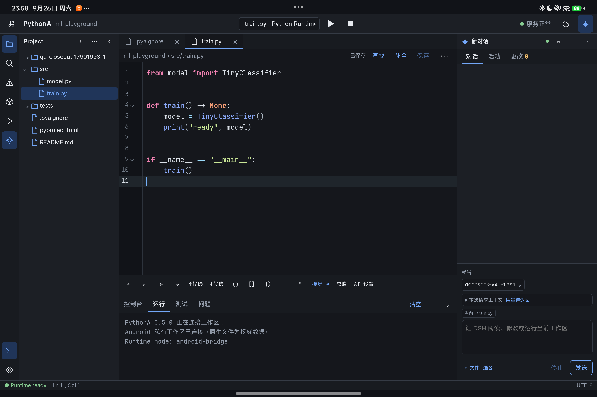
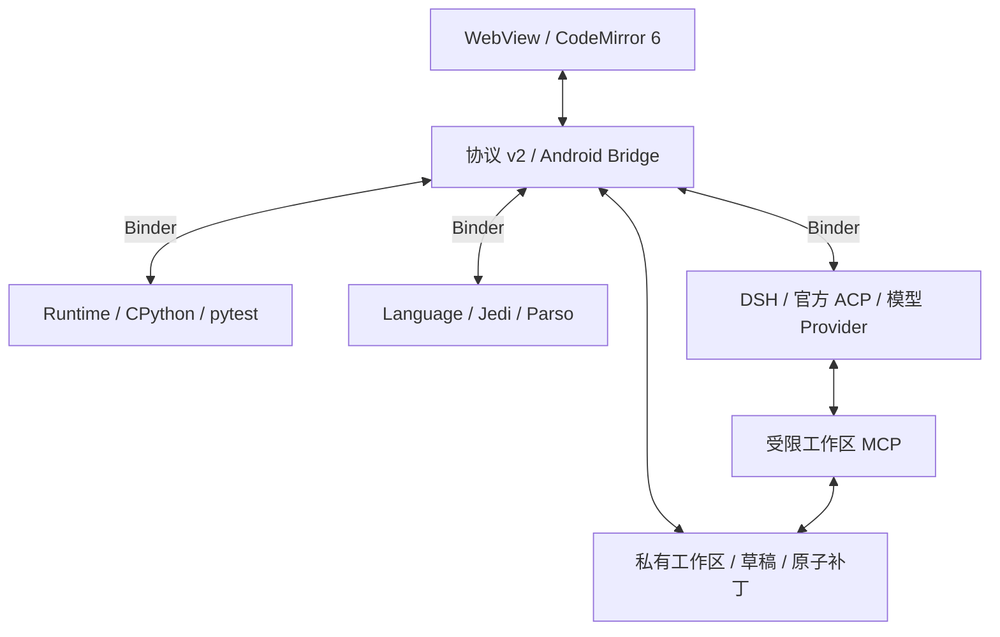

# PythonA

[下载 0.5.0 内测 APK](https://github.com/ym2025szz/PythonA/releases/tag/v0.5.0) · [架构说明](docs/ARCHITECTURE.md) · [验收记录](release/UX_ACCEPTANCE_0.5.0_2026-09-26.md)

当前公开快照为 **0.5.0 内测版**：浅色补全、AI 续写、多文件草稿、官方 DSH 连续会话、统一模型选择、测试与安全重构。APK 为 debug 签名；API 30、同机 0.3 性能对比及长期验收仍待完成。公开代码不等于生产版发布或已完成第三方发行审计。



PythonA `0.5.0` 是面向横屏 Android 平板的本地 Python IDE。它在一个 APK
中提供桌面式代码编辑、应用私有真实文件工作区、内置官方 dsh ACP、独立进程的
Python 运行服务和 Jedi 语义服务；已实现的运行、补全和文件修改都不依赖电脑。

## 平台与能力边界

- Android API 30 及以上，仅构建 `arm64-v8a`，界面只适配横屏平板。系统还需
  Android System WebView/Chromium 93 或更高版本，建议更新到设备可用的最新
  WebView；API 30 是应用与原生运行时的最低基线。
- 编辑器基于 CodeMirror 6，支持 Python 语法高亮、行号、折叠、括号匹配、
  搜索/替换、多光标、片段与本地补全，并保存各标签的选择、滚动、折叠和
  撤销历史。
- Android 构建内置官方 CPython `3.14.7` Android ARM64 分发，运行
  脚本时提供 stdout/stderr 流、`input()`、停止和运行进程恢复。
- Python Console 是受管脚本控制台，不是 Bash、PTY 或完整 Linux 终端；
  不承诺任意 `subprocess`、系统包管理器或桌面二进制兼容性。
- Jedi `0.20.0` + Parso `0.8.7` 提供补全、悬停、签名、定义、文档符号、引用
  查找、受工作区限制的重命名和 Python 语法诊断。当前诊断不是完整类型检查；
  Pyright 不属于 `0.5.0`。重命名先生成 Diff，再由带 revision/hash 校验的
  `MultiFilePatchTransaction` 原子提交。
- `:runtime` 内置锁定版本的 pytest 9.0.3 及其精确依赖，并在不可用时回退到
  unittest。测试任务只能使用结构化 argv，在 Runtime 执行门控内运行；进程
  隔离仍是故障隔离，不是恶意代码沙箱。
  pytest 及其插件入口只进入 Runtime 的 site-packages；Language 只从独立的
  language-site-packages 加载 Jedi/Parso，避免测试插件污染语义服务。
- 官方 dsh 由独立 `:dsh` 原生进程直接启动，模型目录、会话、工具和权限遵循 ACP；Key 由 Android Keystore 保护，
  WebView、Runtime 与 Language 进程不具备 `INTERNET` 权限。
- 设置中的“配置自定义 Provider”打开原生窗口，可填写 Provider 名称、OpenAI
  Chat Completions Base URL、模型 ID 和 Key。自定义路由写入官方 dsh 的
  `llm-pi-ai.providers.pythona-custom`，Key 只通过 `PYTHONA_CUSTOM_API_KEY`
  凭据引用解析，不写入 WebView、工作区或普通 Run 环境。Base URL 默认要求
  HTTPS；HTTP 仅允许用户明确勾选本机回环端点。
- Android 端的工作区根目录固定在应用私有存储；当前 SAF 入口用于选择单个
  纯 Python wheel 或已签名的 `.pya-pack`。浏览器回退层仍支持目录导入/导出，
  但 Android 原生工作区不会把用户选择的外部目录直接映射成项目根目录。
- 二进制文件和超过 8 MiB 的文件保留在真实工作区中，但 Project 树只显示
  路径、大小、revision/hash 等元数据，不把内容载入 WebView 编辑器。
- 基础运行时排除了 `ensurepip`，但提供经过原生策略校验的本地 SAF 纯 Python
  wheel 安装入口。只接受 `py3-none-any` / `py314-none-any`，拒绝 sdist、
  manylinux/musllinux、原生扩展、路径穿越、链接、重复项和超限内容；当前不
  提供在线索引、依赖自动解析、卸载命令或任意 `pip` 执行。
- NumPy 与 PyTorch 不在基础 APK 中，且当前仓库没有发布可用的 NumPy 或
  PyTorch `.pya-pack`。在签名 ARM64 CPU 包完成验收前，UI 必须显示
  “实验包不可用”；不能把 Stub 或桌面 wheel 当作真实支持。
- PyTorch 的未来目标仅为 ARM64 CPU 单进程训练/推理；CUDA、distributed、
  多进程 DataLoader 和完整桌面兼容性不在承诺范围内。
- 不提供竖屏布局和 Minimap。

## 架构

前端通过协议 v2 连接 Android 主进程，后者调度三个独立服务。官方 dsh 通过工作区 MCP 提议修改，用户查看 Diff 后才允许原子提交。详见[完整架构说明](docs/ARCHITECTURE.md)。



工作区位于应用私有目录
`filesDir/workspaces/<workspaceId>/root`。`WorkspaceRepository` 负责路径
约束、原子写入、SHA-256、单调 revision 和递归文件事件。编辑缓冲区另有
独立的 `bufferVersion`；文件事件、Jedi 响应和 DSH 补丁只有在 URI、epoch
和版本均匹配时才可应用。当前没有把工作区映射到用户选择的 SAF 目录。

`:language`、`:runtime` 与 `:dsh` 是独立 Android 进程。当前实现使用 Android Binder
`Messenger`，而不是计划草案中的字面 AIDL 接口；协议仍是版本化、异步、可
取消并支持大消息落盘转运。用户脚本的崩溃、OOM 或 `os._exit` 不应带走编辑器
和语言服务。Jedi 使用单线程 worker，且不加载不安全的第三方原生扩展；它会
读取已验签激活运行包的 `stubs/`/`python/`，以及经过完整性复验的纯 Python
wheel。环境变化会重启 Language/Runtime 进程。DSH Preview 使用独立只读编辑状态；官方 dsh 通过受限 workspace MCP 读取工作区，接受补丁后
才写入正式 buffer 并同步语言服务。独立进程仍与应用使用同一 Android UID，
而且 CPython 包含 `ctypes`；它是故障隔离，不是恶意代码安全边界。

运行包安装器只接受 PythonA 信任密钥签名的 `.pya-pack`。它在解压前校验
Ed25519 签名和逐文件 SHA-256，拒绝路径穿越、符号链接、重复项和超限文件，
并在应用私有目录中以 staging、只读原生库、原子激活和失败回滚完成安装。
API 30 上的 Ed25519 校验由 Bouncy Castle 轻量 API 提供。运行包私钥永远
不得进入源码、APK、构建缓存或发布归档。签名只建立“此包由 PythonA 信任
的发布者提供且内容未被篡改”的包管理信任，不会把签名包或其中的 Python/
原生代码变成安全沙箱；只应安装自己信任的包。

前端以单文件离线 bundle 进入 APK，构建时降级 JavaScript 语法并补齐所用
的少量 Web API。应用把 WebView 93 作为实际界面能力下限；目标设备仍须满足 Android API 30 及以上要求；不会在过旧 WebView 提供程序上冒险加载编辑器。

## 仓库结构

- `pythona-app/`：CodeMirror 前端、协调层、异步 broker 和前端测试。
- `android/`：WebView 宿主、工作区、Messenger 服务、JNI 和嵌入式 Python。
- `runtime-packs/`：`.pya-pack` schema、确定性构建/校验工具及测试。
- `runtime-dependencies.lock.json`：进入基础 APK 的固定运行时输入与哈希。
- `licenses/`、`THIRD_PARTY_NOTICES.md`：随发布保留的第三方许可信息。
- `release/`：验收记录、已检查的界面截图与校验和。APK 和大型运行时归档位于 GitHub Releases；当前 APK 标为内测候选。

## 构建准备

需要 JDK 17、Node.js 18+、Gradle 8.5、Android SDK 34 和 NDK
`26.3.11579264`。先运行构建输入下载器。它依据 `runtime-dependencies.lock.json` 校验大小与 SHA-256：

```powershell
python tools/fetch-runtime-inputs.py
```

DSH 的 159 MB 固定 rootfs 从同版本 Release 下载到 `android/app/src/main/assets/dsh-runtime-rootfs.bin`，不进入 Git 历史。以下 CPython 与 wheel 文件从锁定的上游 URL 下载到 `.runtime-cache/`：

- `python-3.14.7-aarch64-linux-android.tar.gz`
- `jedi-0.20.0-py2.py3-none-any.whl`
- `parso-0.8.7-py2.py3-none-any.whl`
- `pytest-9.0.3-py3-none-any.whl`、`iniconfig-2.1.0-py3-none-any.whl`、
  `packaging-25.0-py3-none-any.whl`、`pluggy-1.6.0-py3-none-any.whl`、
  `pygments-2.20.0-py3-none-any.whl`

然后准备 Gradle 期望的目录：

```powershell
New-Item -ItemType Directory -Force .runtime-cache/cpython | Out-Null
New-Item -ItemType Directory -Force .runtime-cache/site-packages | Out-Null
tar -xzf .runtime-cache/python-3.14.7-aarch64-linux-android.tar.gz `
  -C .runtime-cache/cpython
python -m pip install --no-deps --no-compile `
  --target .runtime-cache/site-packages `
  .runtime-cache/jedi-0.20.0-py2.py3-none-any.whl `
  .runtime-cache/parso-0.8.7-py2.py3-none-any.whl `
  .runtime-cache/pytest-9.0.3-py3-none-any.whl `
  .runtime-cache/iniconfig-2.1.0-py3-none-any.whl `
  .runtime-cache/packaging-25.0-py3-none-any.whl `
  .runtime-cache/pluggy-1.6.0-py3-none-any.whl `
  .runtime-cache/pygments-2.20.0-py3-none-any.whl
```

`.runtime-cache/` 只是可重建的本地输入，不得提交。`runtime-pack-private.pem`
之类的私钥即使处于被忽略目录，也不应长期保存在工作区。

## 构建与测试

```powershell
Push-Location pythona-app
npm ci
npm run build
npm test
npm run check
Pop-Location

Push-Location runtime-packs
node --test tests/runtime-pack.test.mjs
Pop-Location

$env:JAVA_HOME='C:\path\to\jdk-17'
$env:ANDROID_HOME='C:\path\to\android-sdk'
Push-Location android
.\gradlew.bat :app:testDebugUnitTest :app:assembleDebug
Pop-Location
```

Gradle 会重新构建前端 bundle，并把裁剪后的 CPython 标准库（不含
`ensurepip` 和 CPython 测试套件）、Jedi/Parso、Python host 脚本和所需
ARM64 共享库放进 APK。`assembleRelease` 本身不等于可信发布：当前候选 APK
使用本地开发签名。正式公开发布前还必须使用受保护的发布密钥签名，在目标
设备上通过运行、输入、停止、服务恢复、Jedi、中文 IME、触控和 DSH 验收，
再生成 `SHA256SUMS`。

## 正式发行待办

- 官方 CPython 3.14.7 Android 二进制分发只附带 CPython 的 `LICENSE.txt`，
  但本地包可确认还包含 OpenSSL、SQLite 及多个静态链接/内嵌第三方组件。
  这些组件的精确许可证、版权和 NOTICE 尚未由该二进制包完整提供。正式公开
  发布 APK 前必须依据相同上游源码与构建配方生成完整物料清单，并补齐
  [THIRD_PARTY_NOTICES.md](THIRD_PARTY_NOTICES.md) 中标出的原文；目前的第三方
  声明不能视为完成的发行合规清单。
- 当前源码公开供查看，尚未为 PythonA 自有代码授予开源许可证。项目许可证由所有者另行决定；第三方组件继续适用各自许可证。
- 当前 0.5.0 APK 是开发签名内测包，在 GitHub 标记为 pre-release；尚未达到生产签名和完整发行验收标准。

## 发布卫生

发布归档只保留源码、锁文件、许可证、APK、已验收的正式 `.pya-pack`、签名
与 `SHA256SUMS`。不要发布 `node_modules`、`.runtime-cache`、Gradle/NDK
构建目录、coverage、设备日志、未经检查的截图、临时 wheel、旧 staging 或任何私钥。
开发签名 APK 必须明确标注为测试候选；大型 APK 和运行包应进入 GitHub
Releases，而不是 Git 历史。

第三方组件及其许可证见 [THIRD_PARTY_NOTICES.md](THIRD_PARTY_NOTICES.md)。
