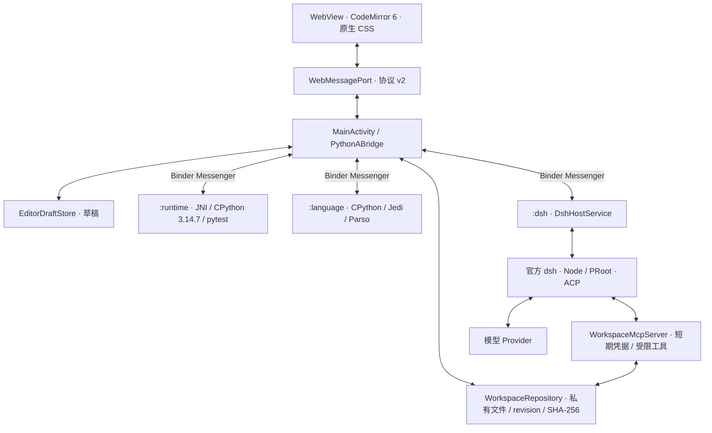

# PythonA 架构

PythonA 是面向 ARM64 横屏 Android 平板的本地 Python IDE。前端负责交互，Android 负责持久化与调度，独立服务承载 Python、语义分析和官方 dsh。当前版本为 0.5.0 内测版。

## 进程与通信

协议采用异步请求、响应与事件；Binder 承担跨进程通信，大消息通过受限 spool 文件转运。请求和事件带任务、会话或进程身份；旧 bufferVersion、epoch、generation 的结果不能覆盖新状态。Runtime、Language 与 DSH 可以分别恢复，进程隔离用于控制故障影响；应用仍采用可信个人脚本模型，**不是恶意代码沙箱**。

## 编辑与数据层

- `pythona-app/src/editor/` 封装 CodeMirror：Python 高亮、补全、装饰层、IME 和触控工具条。
- `DocumentSession` 按文件维护文档、撤销历史、光标、滚动、dirty 与冲突。切换标签不等于保存。
- `WorkspaceRepository` 是正式文件的权威来源，负责路径约束、revision、SHA-256、文件事件与原子写入。
- 草稿由 `EditorDraftStore` 单独持久化；恢复时先比较磁盘版本，外部变化形成冲突而不是被覆盖。
- 浅色补全使用 CodeMirror 装饰，不进入文档；接受建议才产生一次可撤销编辑。本地 Jedi 建议和 AI 续写有独立请求管理。

## 普通运行、测试与语言服务

`RuntimeHostService → PythonEngine/JNI → pythona_runtime_host.py` 执行普通脚本。`pythona_test_host.py` 处理测试发现与运行，优先 pytest，能力不可用时回退 unittest。普通运行和测试共用互斥门控，具有独立任务身份、输出、输入、取消和终态。

`LanguageHostService → pythona_jedi_host.py` 提供补全、定义、引用、符号与重命名。Language 的导入路径与 Runtime 的测试依赖分开，避免 pytest 插件进入语言进程。引用默认限制到工作区；重命名生成跨文件补丁，不使用同名文本替换。

## DSH 与 AI 续写

PythonA 自己启动内置官方 dsh，不需要安装 DSHA。`DirectDshRuntime` 管理 Node/PRoot 和 ACP；`AcpConnection` 处理 JSON-RPC。`DshConversationStore` 保存 PythonA 登记的会话索引、消息及上下文，同一会话通过官方 ACP 恢复历史。

Provider 的 Key 由原生配置和 Android Keystore 保护，不复制到 WebView 的设置、聊天历史或普通 Python 运行环境。官方 dsh 通过带短期凭据的工作区 MCP 读取文件、搜索、查看符号、提议补丁或申请运行。

AI 续写由 `InlineCompletionHost` 独立管理。官方路线使用单次 `ctx.llm.stream()`，不提供 Agent 或 MCP 工具；明确选择兼容 Provider 时使用原生 HTTP 适配器。触发延迟、频率、上下文和返回大小均受限，继续编辑或开始聊天会取消补全。

## 修改的确认与原子性

1. 语言服务或 DSH 生成修改建议。
2. 前端展示所有受影响文件的 Diff，用户确认。
3. 检查相关文件的缓冲区、revision 与 SHA-256。
4. `MultiFilePatchTransaction` 原子提交；任何文件冲突使整批失败。

旧会话和历史补丁只能查看，不能恢复为有效批准。普通 Run/Tests 使用独立确认窗口；DSH 工具授权留在 DSH 面板。

## 源码与发布布局

| 路径 | 内容 |
| --- | --- |
| `pythona-app/` | WebView 前端、状态层、编辑器、前端测试 |
| `android/app/src/main/java/` | Activity、Bridge、服务、工作区、凭据与持久化 |
| `android/app/src/main/cpp/`、`jni/` | CPython JNI 嵌入与 NDK 构建 |
| `android/app/src/main/python/` | Runtime、Jedi 与测试 host |
| `android/app/src/main/assets/` | ACP/补全适配脚本与 DSH 运行时清单 |
| `runtime-packs/` | 可选签名运行包的格式、构建与校验工具 |
| `runtime-dependencies.lock.json` | 固定版本、大小与 SHA-256 |
| `licenses/`、`THIRD_PARTY_NOTICES.md` | 第三方归属与许可资料 |
| `release/` | 验收记录、截图与校验和；大型二进制位于 GitHub Releases |

源码的 Git 提交归属与第三方组件的版权归属是两回事。仓库的初始源码快照由维护者 `ym2025szz` 提交；上游许可与版权声明继续保留。

## 验证边界

0.5.0 已在小米 M367FC / Android 17 / API 37 验证。自动测试与真机结果见[验收记录](../release/UX_ACCEPTANCE_0.5.0_2026-09-26.md)。API 30、完整外接键盘兼容、多小时压力与同机 0.3 性能对比尚未完成；不将桌面测试或单次采样当作这些验收的替代。
